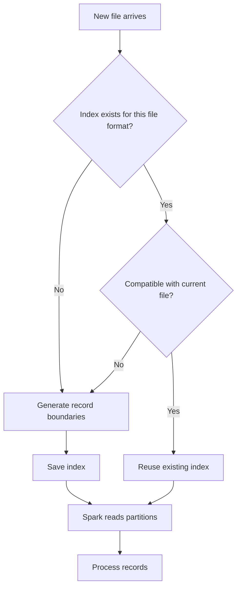

# EcoPass Scala Record Reader

Scala conversion of the supplied Python `RecordHeader` reader.


## usecase:



## Compatibility

- Scala: 2.12.15
- Spark: 3.3.3 (Scala 2.12 build)
- JDK: 11
- No external runtime dependencies are required by this reader.

## Build

Install an sbt 1.x launcher, then run:

```bash
sbt clean package
```

The JAR is created at:

```text
target/scala-2.12/ecopass-record-reader_2.12-0.1.0.jar
```

The `project/build.properties` file pins sbt 1.10.7. If you intentionally use
another sbt release, change that file to the version installed in your environment.
The sbt version is separate from the Scala version and Spark version.

## Use from PySpark

```bash
pyspark --jars target/scala-2.12/ecopass-record-reader_2.12-0.1.0.jar
```

Then:

```python
reader = spark._jvm.io.github.yassinessadi.ecopass.RecordHeaderReader(2, 2, True)
records = reader.readRecords(INPUT_FILE)

for i in range(records.size()):
    record = records.get(i)
    status = record.status()
    length = record.length()
    payload = bytes(bytearray(record.data()))
    print(status, record.recordTypeName(), length, payload)
```

You can also add the JAR when creating the Spark session:

```python
spark = (
    SparkSession.builder
    .appName("EcoPassTest")
    .config("spark.jars", "/path/to/ecopass-record-reader_2.12-0.1.0.jar")
    .getOrCreate()
)
```

## Important behavior

- Header size must be 2 or 4 bytes.
- The status is the high nibble of the first byte.
- Payload length is decoded from the remaining 12 or 28 bits.
- Padding aligns `(headerSize + payloadLength)` to `alignment`.
- The allowed statuses mirror the Python list. Status 13 is defined but excluded,
  because the supplied Python implementation did not include it in `allowed_statuses`.
- `readRecords` returns a Java list for easy Py4J access, so it loads the file's
  records into JVM memory. It is suitable for initial testing, not huge production files.
