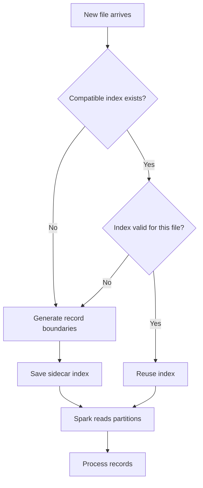

# EcoPass Record Reader

**A native Apache Spark DataSource for reading binary record-oriented files.**

EcoPass is a Scala-based binary record reader that integrates directly with Apache Spark through DataSource V2.

Instead of loading an entire file into memory, EcoPass scans record boundaries, generates a sidecar index, and allows Spark to read complete records through parallel partitions.

## Use case



An index contains record offsets and partition boundaries for a specific file. If another file follows the same format but contains different data, EcoPass reuses the framing rules but generates new boundaries.

## How it works

### 1. Binary header format

EcoPass supports 2-byte and 4-byte headers.

For a 2-byte header:

```text
+----------------+----------------+
| Status | Length|     Length     |
|  4 bits| 4 bits|     8 bits     |
+----------------+----------------+
```

The first byte contains the status in its high nibble and the upper 4 bits of the payload length.

The second byte contains the remaining 8 bits.

The parsing logic is:

```scala
val status = (byte0 >> 4) & 0x0F

val length =
  ((byte0 & 0x0F) << 8) | byte1
```

For a 4-byte header, the payload length uses the remaining 28 bits:

```scala
val status = (byte0 >> 4) & 0x0F

val length =
  ((byte0 & 0x0F).toLong << 24) |
  (byte1.toLong << 16) |
  (byte2.toLong << 8) |
  byte3.toLong
```

### 2. Record boundary calculation

Each record contains:

- Header
- Payload
- Optional padding

The total record size is:

$$
S = H + L + P
$$

Where:

- \(H\) = Header size in bytes.
- \(L\) = Payload length in bytes.
- \(P\) = Padding size in bytes.

For fixed alignment, padding is calculated using:

$$
P = \left(A - \left((H + L) \bmod A\right)\right) \bmod A
$$

Where \(A\) is the required alignment.

The next record starts at:

$$
O_{\text{next}} = O_{\text{current}} + H + L + P
$$

**Example:**

For a 2-byte header, 5-byte payload, and alignment of 2:

$$
P = (2 - (7 \bmod 2)) \bmod 2 = 1
$$

Therefore:

```text
Header:       2 bytes
Payload:      5 bytes
Padding:      1 byte
--------------------
Record size:  8 bytes
```

If the current record starts at offset 0, the next record starts at offset 8.

EcoPass uses `Long` offsets to support files larger than 2 GB.

### 3. Index generation

EcoPass scans the file sequentially to discover record boundaries.

It does not need to load the entire file into memory to generate the index.

The index builder groups complete records into Spark partitions. The default target partition size is 256 MiB.

The sidecar index stores:

- Source file path
- File size
- Modification time
- Format version
- Index version
- Total record count
- Partition offsets and record ranges

## Compatibility

| Component | Version |
|---|---|
| Scala | 2.12.15 |
| Apache Spark | 3.3.3 (Scala 2.12 build) |
| JDK | 11 |
| sbt | 1.10.7 |

## Build

Install an sbt 1.x launcher, then run:

```bash
sbt clean test package
```

The JAR is created at:

```text
target/scala-2.12/ecopass_2.12-0.2.0.jar
```

The `project/build.properties` file pins sbt 1.10.7. The sbt version is separate from the Scala and Spark versions.

## Use from PySpark

### 1. Start Spark with EcoPass

```bash
pyspark \
  --jars target/scala-2.12/ecopass_2.12-0.2.0.jar
```

Alternatively, configure the JAR when creating your Spark session:

```python
from pyspark.sql import SparkSession

spark = (
    SparkSession.builder
    .appName("EcoPassExample")
    .config(
        "spark.jars",
        "/path/to/ecopass_2.12-0.2.0.jar"
    )
    .getOrCreate()
)
```

### 2. Generate the index

The current EcoPass facade provides a convenience method using 2-byte headers and 2-byte alignment:

```python
from pathlib import Path

INPUT_FILE = Path("example/sample.dat")
INDEX_FILE = Path("example/sample.epidx")

eco_pass = spark._jvm.io.github.yassinessadi.ecopass.EcoPass

index = eco_pass.generateIndex(
    str(INPUT_FILE.resolve()),
    str(INDEX_FILE.resolve())
)

print("Records:", index.totalRecords())
print("Partitions:", index.partitions().size())
```

For a different fixed header size or alignment:

```python
index = eco_pass.generateIndex(
    str(INPUT_FILE.resolve()),
    str(INDEX_FILE.resolve()),
    2,
    2
)
```

### 3. Read the file as a Spark DataFrame

```python
df = (
    spark.read
    .format("ecopass")
    .option("indexPath", str(INDEX_FILE.resolve()))
    .load(str(INPUT_FILE.resolve()))
)

df.show(10, truncate=False)
```

EcoPass reads the indexed record partitions through its native Spark DataSource V2 implementation.

### 4. Process records with Spark

Filter records by status:

```python
from pyspark.sql.functions import col

normal_records = df.filter(
    col("status") == 4
)
```

Inspect record metadata:

```python
df.select(
    "status",
    "record_type",
    "length",
    "record_offset"
).show(10, truncate=False)
```

Decode payloads for text inspection:

```python
from pyspark.sql.functions import col, decode

df_text = df.withColumn(
    "data",
    decode(col("data"), "ISO-8859-1")
)

df_text.show(10, truncate=False)
```

The default `data` column remains binary to preserve the original bytes. Choose an encoding appropriate to the source file; mainframe data may use EBCDIC rather than ISO-8859-1.

## Output schema

| Column | Spark type | Description |
|---|---|---|
| `status` | IntegerType | Numeric record status |
| `record_type` | StringType | Record type name |
| `length` | LongType | Payload length |
| `data` | BinaryType | Original binary payload |
| `record_offset` | LongType | Record starting offset |
| `header_size` | IntegerType | Header size |
| `padding_size` | IntegerType | Padding size |

## Index reuse

EcoPass separates file framing rules from file-specific index data.

For example:

```text
incoming/
├── spdd.00
├── spdd.00
└── spd.a00
```

- The first `spdd.00` arrival requires index generation.
- An identical, compatible `spdd.00` file can reuse its existing index.
- A new `spd.a00` format requires its own framing configuration and index.
- A different file with the same format but different record boundaries requires a new index.

The current implementation validates indexes using file size and modification time. These checks do not guarantee byte-for-byte identity.

The current index store uses local Java NIO paths. Hadoop FileSystem and HDFS sidecar support are future improvements.

## Important behavior

- Header size must be 2 or 4 bytes.
- Status is extracted from the high nibble of the first byte.
- Payload length is decoded from the remaining 12 or 28 bits.
- Padding is calculated from header size, payload length, and alignment.
- Record boundaries include padding.
- Index generation scans records sequentially.
- Spark reads complete indexed records in parallel partitions.
- Unknown statuses follow the configured `Keep`, `Skip`, or `Fail` policy.
- Skipped records must still be consumed to preserve correct record boundaries.
- Individual payloads use JVM byte arrays and must fit within the JVM array-size limit.

## Project status

**EcoPass Core 0.2.0** establishes the foundation for binary record parsing, indexing, and native Spark integration.

Future improvements include:

- Hadoop FileSystem and HDFS index storage.
- Multi-file Spark DataSource planning.
- Stronger index fingerprint validation.
- COBOL copybook integration.
- EBCDIC, COMP, and COMP-3 decoding.
- Large-file performance benchmarks.

## License

See the repository's `LICENSE` file.

## Project

**EcoPass — Binary Record Processing for Apache Spark**

GitHub: https://github.com/yassinessadi/Ecopass-cobol

Author and maintainer: Yassine Essadi