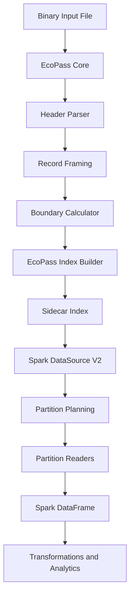
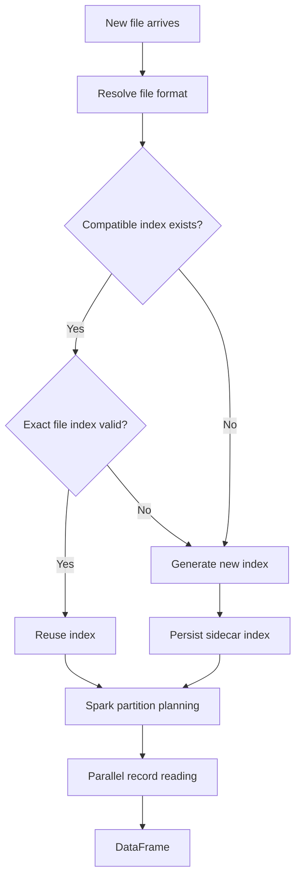

# EcoPass

**A native Scala-based Apache Spark DataSource for reading binary record-oriented files.**

EcoPass is an extensible binary record reader designed to process large record-oriented files using Apache Spark. It provides configurable record framing, binary header parsing, record boundary indexing, and partition-based parallel reading through Spark's DataSource V2 API.

The project aims to make large binary files accessible to Spark without loading an entire file into driver memory or requiring users to implement custom record-reading logic in every application.

> **Current release:** 0.2.0 (Core foundation)

---

## Table of Contents

- [Overview](#overview)
- [Why EcoPass?](#why-ecopass)
- [Architecture](#architecture)
- [How It Works](#how-it-works)
- [Features](#features)
- [Record Format](#record-format)
- [Installation](#installation)
- [Build from Source](#build-from-source)
- [Quick Start](#quick-start)
- [Index Generation](#index-generation)
- [Reading with Spark](#reading-with-spark)
- [Output Schema](#output-schema)
- [Record Statuses](#record-statuses)
- [Index Management and Reuse](#index-management-and-reuse)
- [Configuration](#configuration)
- [Performance and Scalability](#performance-and-scalability)
- [Limitations](#limitations)
- [Roadmap](#roadmap)
- [Contributing](#contributing)
- [License](#license)

---

## Overview

Traditional binary file readers often process records sequentially and return collections of records to the application. This approach can become inefficient when processing large files because it may require loading substantial amounts of data into memory.

EcoPass takes a different approach.

It separates record boundary discovery from record processing:

1. Scan a binary file sequentially to identify record boundaries.
2. Generate a sidecar index containing record offsets and Spark partition ranges.
3. Persist the index for potential reuse.
4. Let Spark read indexed record ranges in parallel.
5. Return records as a standard Spark DataFrame.

This architecture allows Spark applications to work with binary record-oriented files through a familiar DataFrame API.

### Design goal

```python
df = (
    spark.read
    .format("ecopass")
    .option("indexPath", index_path)
    .load(file_path)
)
```

The objective is to make binary record ingestion as straightforward as reading CSV, JSON, or Parquet files.

---

## Why EcoPass?

EcoPass focuses on the challenges of reading large binary files:

| Challenge | EcoPass approach |
|---|---|
| Binary record boundaries | Configurable header parsing and framing |
| Variable record lengths | Record boundary calculation |
| Files larger than 2 GB | Long-based file offsets |
| Large files and memory pressure | Sequential indexing and partition-based reading |
| Parallel processing | Spark DataSource V2 |
| Repeated file processing | Persistent sidecar indexes |
| Binary payload preservation | Spark BinaryType |
| Different record formats | Header and padding resolver abstractions |

EcoPass is designed as a reusable core library rather than a parser tied to one specific file layout.

---

## Architecture

EcoPass is organized around three main responsibilities:

1. **Core:** Understand record headers, statuses, lengths, and framing.
2. **Indexing:** Discover record boundaries and organize them into Spark-readable partitions.
3. **Spark:** Expose the indexed binary records through DataSource V2.

### High-level architecture



### Main components

| Component | Responsibility |
|---|---|
| RecordHeaderParser | Decode binary record headers |
| RecordType | Resolve record status names |
| RecordFramingPolicy | Define header, padding, and invalid-status behavior |
| HeaderFormatResolver | Determine header size |
| PaddingResolver | Determine record padding |
| RecordBoundaryCalculator | Calculate record start and end offsets |
| EcoPassIndexBuilder | Build index partitions |
| EcoPassIndexStore | Persist and load sidecar indexes |
| EcoPassIndexGenerator | Scan files and generate indexes |
| EcoPassDataSource | Register EcoPass as a Spark data source |
| EcoPassScanBuilder | Build Spark scan plans |
| EcoPassPartitionReader | Read complete records within assigned ranges |

---

## How It Works

EcoPass uses a two-stage reading strategy.

### Stage 1: Index generation

The index generator scans the source file sequentially.

For each record, it:

1. Reads the record header.
2. Resolves the header size.
3. Extracts the record status.
4. Decodes the payload length.
5. Calculates the padding.
6. Calculates the record boundary.
7. Skips the payload and padding without retaining the entire file in memory.
8. Adds the boundary to the index builder.

The index builder groups complete records into partitions according to a target byte size.

### Stage 2: Parallel Spark reading

When Spark reads the file:

1. EcoPass loads the sidecar index.
2. The index is validated against the source file.
3. Spark receives partition descriptions.
4. Each partition reader seeks to its assigned offset.
5. Complete records are parsed and returned as DataFrame rows.



**Important:** A format profile and a file index are different things. Reusing framing rules does not automatically mean that record offsets can be reused. Exact offsets are reusable only when the incoming file is compatible with the indexed file.

---

## Features

### Binary header parsing

- Supports 2-byte and 4-byte record headers.
- Extracts record status from the first byte.
- Decodes payload lengths using unsigned byte operations.
- Uses Long values for file offsets and record boundaries.

### Configurable framing

- Fixed header sizes.
- Header size resolution by status.
- Header size resolution by file offset ranges.
- Fixed alignment padding.
- Padding resolution by record status.
- Configurable invalid-status handling.

### Record indexing

- Sequential record boundary discovery.
- Sidecar index serialization.
- Index metadata validation.
- Partition grouping based on target bytes.
- Complete-record partition boundaries.

### Native Spark integration

- Spark DataSource V2 integration.
- DataFrame API access.
- Partition-based reading.
- BinaryType payload preservation.
- Support for Spark's distributed execution model.

---

## Record Format

EcoPass currently implements the following binary header interpretation.

### 2-byte header

The first byte contains:

- High 4 bits: record status.
- Low 4 bits: upper part of payload length.

The second byte contains the remaining 8 bits.

```text
+----------------+----------------+
| Status | Length|   Length       |
|  4 bits| 4 bits|   8 bits       |
+----------------+----------------+
```

The payload length is calculated as:

```scala
val status = (byte0 >> 4) & 0x0F

val length =
  ((byte0 & 0x0F) << 8) | byte1
```

### 4-byte header

The first byte contains the status and the upper 4 bits of the length. The remaining three bytes contain the other 24 bits.

```scala
val status = (byte0 >> 4) & 0x0F

val length =
  ((byte0 & 0x0F).toLong << 24) |
  (byte1.toLong << 16) |
  (byte2.toLong << 8) |
  byte3.toLong
```

### Padding calculation

For fixed alignment:

```scala
val totalSize = headerSize + payloadLength

val padding =
  (alignment - (totalSize % alignment)) % alignment
```

For example, with a 2-byte header, 5-byte payload, and alignment of 2:

```text
Header:   2 bytes
Payload:  5 bytes
Padding:  1 byte
-----------------
Total:    8 bytes
```

EcoPass consumes padding when determining the next record boundary.

---

## Installation

### Requirements

| Component | Version |
|---|---|
| Scala | 2.12.15 |
| Apache Spark | 3.3.3 |
| JDK | 11 |
| sbt | 1.10.7 |

EcoPass targets the Spark 3.3.3 Scala 2.12 ecosystem.

### Build the JAR

Clone the repository:

```bash
git clone https://github.com/yassinessadi/Ecopass-cobol.git

cd Ecopass-cobol
```

Build:

```bash
sbt clean test package
```

The generated artifact should be:

```text
target/scala-2.12/ecopass_2.12-0.2.0.jar
```

The project pins sbt 1.10.7 in:

```text
project/build.properties
```

---

## Quick Start

### 1. Start Spark with EcoPass

```bash
spark-submit \
  --master local[*] \
  --jars target/scala-2.12/ecopass_2.12-0.2.0.jar \
  example/native_test.py
```

Alternatively, add the JAR to your Spark session:

```python
from pyspark.sql import SparkSession

spark = (
    SparkSession.builder
    .appName("EcoPassExample")
    .config(
        "spark.jars",
        "/path/to/ecopass_2.12-0.2.0.jar"
    )
    .getOrCreate()
)
```

### 2. Generate an index

The current Java/Scala facade provides a convenience method using 2-byte headers and 2-byte alignment:

```python
from pathlib import Path

INPUT_FILE = Path("example/sample.dat")
INDEX_FILE = Path("example/sample.epidx")

eco_pass = spark._jvm.io.github.yassinessadi.ecopass.EcoPass

index = eco_pass.generateIndex(
    str(INPUT_FILE.resolve()),
    str(INDEX_FILE.resolve())
)

print("Records:", index.totalRecords())
print("Partitions:", index.partitions().size())
```

For custom header size and alignment:

```python
index = eco_pass.generateIndex(
    str(INPUT_FILE.resolve()),
    str(INDEX_FILE.resolve()),
    2,
    2
)
```

### 3. Read with the native Spark DataSource

```python
df = (
    spark.read
    .format("ecopass")
    .option("indexPath", str(INDEX_FILE.resolve()))
    .load(str(INPUT_FILE.resolve()))
)

df.show(10, truncate=False)
```

The resulting DataFrame can be used with normal Spark SQL and DataFrame operations.

---

## Index Generation

Index generation is a separate operation from Spark reading.

This separation is intentional: the index can be generated once and reused when the exact indexed file is processed again.

### Example

```text
example/
├── sample.dat
├── sample.epidx
├── generate_index.py
└── native_test.py
```

### Index metadata

The current sidecar index stores:

- Source path.
- Source file size.
- Source modification time.
- Format version.
- Index version.
- Total record count.
- Partition descriptions.
- Record offset ranges.

The index format uses the `EPIX` magic identifier and a version field.

### Partition strategy

EcoPass groups complete records into partitions using a configurable target byte size.

The default target partition size is:

```scala
256L * 1024L * 1024L
```

That is 256 MiB.

A record is never intentionally split between two partitions.

---

## Reading with Spark

EcoPass exposes the following DataFrame API:

```python
df = (
    spark.read
    .format("ecopass")
    .option("indexPath", index_path)
    .load(input_path)
)
```

### Inspect records

```python
df.printSchema()

df.show(10, truncate=False)
```

### Filter by record status

```python
from pyspark.sql.functions import col

normal_records = df.filter(
    col("status") == 4
)
```

### Inspect record sizes

```python
df.select(
    "status",
    "record_type",
    "length",
    "record_offset"
).show(20, truncate=False)
```

### Decode payloads for text inspection

EcoPass preserves payloads as binary data by default.

For text-oriented records, you can decode the payload in Spark:

```python
from pyspark.sql.functions import col, decode

df_text = df.withColumn(
    "data",
    decode(col("data"), "ISO-8859-1")
)

df_text.show(10, truncate=False)
```

The selected character encoding must match the source file. ISO-8859-1 is only an example; mainframe files may use EBCDIC encodings.

For production processing, retain the binary payload until the correct field-level decoding rules are applied.

---

## Output Schema

The current DataSource exposes the following columns:

| Column | Spark type | Description |
|---|---|---|
| `status` | IntegerType | Numeric record status |
| `record_type` | StringType | Human-readable record type |
| `length` | LongType | Payload length in bytes |
| `data` | BinaryType | Original binary payload |
| `record_offset` | LongType | Record start offset in the file |
| `header_size` | IntegerType | Header size in bytes |
| `padding_size` | IntegerType | Padding size in bytes |

### Example output

```text
+------+----------------+------+----------------------+-------------+-----------+------------+
|status|record_type     |length|data                  |record_offset|header_size|padding_size|
+------+----------------+------+----------------------+-------------+-----------+------------+
|4     |NORMAL_USER_DATA|5     |[48 45 4C 4C 4F]      |0            |2          |1           |
|3     |SYSTEM_RESERVED |7     |[45 43 4F 50 41 53 53]|8            |2          |1           |
|7     |USER_DATA_RECORD|5     |[53 50 41 52 4B]      |18           |2          |1           |
+------+----------------+------+----------------------+-------------+-----------+------------+
```

The `data` column remains binary to preserve the original payload bytes.

---

## Record Statuses

The current status mapping includes the following record types:

| Status | Record type |
|---:|---|
| 0 | NULL_RECORD |
| 1 | SYSTEM_RECORD_DUPLICATE |
| 2 | DELETED_RECORD |
| 3 | SYSTEM_RESERVED |
| 4 | NORMAL_USER_DATA |
| 5 | REDUCED_USER_DATA |
| 6 | POINTER_RECORD |
| 7 | USER_DATA_RECORD |
| 8 | REDUCED_USER_DATA_REFERENCED_BY_POINTER |
| 9 | RESERVED_FOR_FUTURE_USE |
| 10 | MID_TRANSACTION_USER_RECORD |
| 11 | MID_TRANSACTION_REDUCED_USER_RECORD |
| 12 | MID_TRANSACTION_USER_RECORD_REFERENCED |
| 13 | MID_TRANSACTION_REDUCED_USER_RECORD_REFERENCED |

Unknown statuses are handled according to the configured invalid-status policy.

The current implementation supports:

- `Keep`: retain unknown-status records.
- `Skip`: skip emitting unknown-status records.
- `Fail`: fail when an unknown status is encountered.

A skipped record must still be consumed during scanning and reading so that subsequent record boundaries remain correct.

---

## Index Management and Reuse

EcoPass distinguishes between a **file format profile** and a **file-specific index**.

A format profile defines how to interpret record headers, payload lengths, and padding.

A file-specific index contains the actual record offsets and partition boundaries for one particular file.

### Example: recurring files

Consider a recurring ingestion workload:

```text
incoming/
├── spdd.00
├── spdd.00
├── spdd.00
└── spd.a00
```

The files may follow two different record formats.

A possible index organization:

```text
indexes/
├── spdd_00/
│   └── file_index.epidx
└── spd_a00/
    └── file_index.epidx
```

### Reuse rules

| Scenario | Behavior |
|---|---|
| Same exact file and valid index | Reuse the index |
| Same format, different file content | Generate new boundaries |
| New file format | Resolve its framing configuration and generate a new index |
| File size or modification metadata changes | Invalidate and regenerate |
| Index format version changes | Regenerate or migrate |

**Important:** The current index store validates file size and modification time. These checks are useful but do not guarantee byte-for-byte identity. Stronger validation, such as checksums or content fingerprints, is a future improvement.

The current index store also uses Java NIO local filesystem paths. HDFS-compatible sidecar storage is part of the future development roadmap.

---

## Configuration

EcoPass provides configurable framing abstractions.

### Header format resolver

Supported resolver strategies include:

- `Fixed`: use one header size.
- `ByStatus`: resolve header size from record status.
- `ByOffset`: resolve header size from file offset ranges.

Example:

```scala
HeaderFormatResolver.Fixed(2)
```

### Padding resolver

Supported strategies include:

- `None`: no padding.
- `FixedAlignment`: calculate padding using a fixed alignment.
- `ByStatus`: resolve padding according to record status.

Example:

```scala
PaddingResolver.FixedAlignment(2)
```

### Record framing policy

A framing policy combines the header resolver, padding resolver, invalid-status policy, and maximum payload length.

Conceptually:

```scala
val policy = RecordFramingPolicy(
  headerFormatResolver =
    HeaderFormatResolver.Fixed(2),

  paddingResolver =
    PaddingResolver.FixedAlignment(2),

  invalidStatusPolicy =
    InvalidStatusPolicy.Skip
)
```

The exact policy used during index generation must also be used during Spark reading. Different framing configurations can produce incorrect record boundaries.

---

## Performance and Scalability

EcoPass is designed around offset-based reading rather than loading an entire file into memory.

### Large-file design considerations

- File offsets and boundaries use `Long`.
- Index generation is sequential and does not retain the entire input file.
- Partition readers seek to indexed offsets.
- Spark distributes partition processing across executors.
- Sidecar indexes can avoid repeating boundary discovery for the same compatible file.
- Payloads are read as binary records.

### Partition sizing

The default partition target is 256 MiB.

For a large file, the index builder groups complete records into approximately this size, subject to record boundaries.

The optimal partition size depends on:

- Executor memory.
- Executor cores.
- File size.
- Average record size.
- Payload processing cost.
- Storage throughput.
- Number of concurrent Spark tasks.

### Benchmarking

A recommended benchmark progression:

| File size | Objective |
|---|---|
| 1 GB | Validate basic performance |
| 10 GB | Validate large-file indexing |
| 20 GB | Validate partition reading |
| 50 GB | Measure sustained throughput |
| 100 GB | Evaluate production-scale behavior |

Measure:

- Index generation time.
- Index file size.
- Records per second.
- MB/s throughput.
- Spark execution time.
- Executor memory usage.
- Garbage collection.
- Partition distribution.
- Correctness against a sequential reference reader.

These are proposed benchmark targets, not published performance results. EcoPass has not yet established measured 20–100 GB throughput.

---

## Limitations

EcoPass Core 0.2.0 establishes the foundation for binary record reading and Spark integration. It should not yet be considered a complete COBOL data interpretation engine.

Current limitations include:

1. The index generator uses local Java NIO rather than Hadoop FileSystem for sidecar storage.
2. The current DataSource workflow is focused on a single indexed file.
3. Index generation is a sequential scan.
4. Each individual payload is represented by a JVM byte array and must fit within the JVM array-size limit.
5. File size and modification time validation do not provide cryptographic content verification.
6. COBOL copybook interpretation is not yet part of the core DataSource.
7. EBCDIC, COMP, COMP-3, and other COBOL field decoding require additional implementation.
8. Production-scale performance has not yet been established through large-file benchmarks.

---

## Roadmap

### EcoPass Core
---
- [x] Scala binary header parser
- [x] 2-byte and 4-byte header support
- [x] Record status resolution
- [x] Configurable record framing
- [x] Configurable padding resolution
- [x] Long-based record boundary calculation
- [x] Sidecar index generation
- [x] Sidecar index persistence
- [x] Index validation foundation
- [x] Spark DataSource V2 integration
- [x] Partition-based reading
- [x] Binary payload preservation
- [x] Unit and integration testing foundation

### Future development
---
- [ ] Hadoop FileSystem-compatible index storage
- [ ] HDFS sidecar index support
- [ ] Multi-file DataSource planning
- [ ] Format profile registry
- [ ] Stronger file fingerprint validation
- [ ] Distributed or optimized index generation
- [ ] Advanced corruption detection and recovery
- [ ] Large-file benchmark suite
- [ ] Configurable EBCDIC decoding
- [ ] COBOL copybook integration
- [ ] COMP and COMP-3 decoding
- [ ] Schema-aware record interpretation
- [ ] Improved Spark partition planning

---

## Contributing

Contributions, suggestions, testing, and architectural feedback are welcome.

If you are working on binary record processing, mainframe ingestion, COBOL data, or Spark connectors, your feedback can help improve EcoPass.

### Development workflow

```bash
git clone https://github.com/yassinessadi/Ecopass-cobol.git

cd Ecopass-cobol

sbt clean test

sbt package
```

For larger changes, please open an issue before submitting a pull request.

---

## License

See the repository's `LICENSE` file for licensing information.

---

## Project

**EcoPass — Binary Record Processing for Apache Spark**

GitHub: https://github.com/yassinessadi/Ecopass-cobol

Author and maintainer: Yassine Essadi

EcoPass aims to provide a reusable foundation for reading, indexing, and processing large binary record-oriented files in distributed data engineering environments.